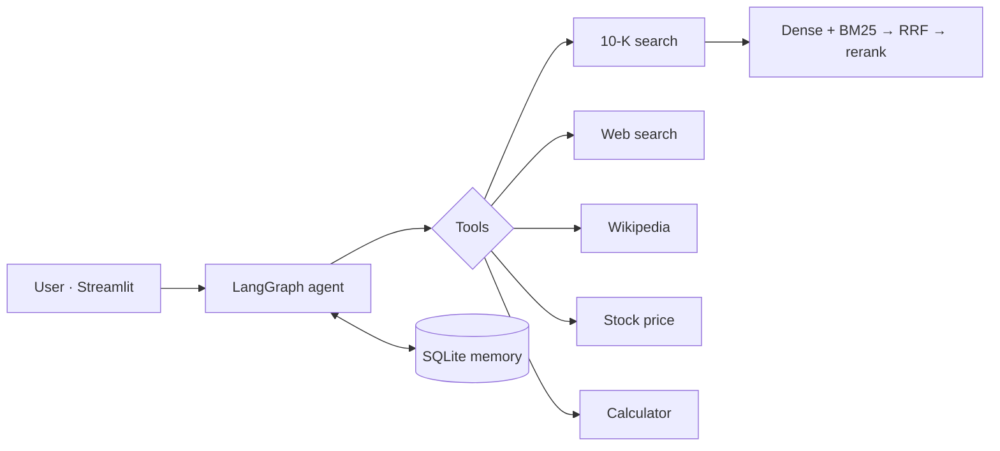

# Multi-Source Agentic RAG

A financial research assistant for Apple, Amazon, Microsoft and NVIDIA. For each question, a
LangGraph agent picks from five tools: search over the companies' 10-K filings, web search,
Wikipedia, live stock prices and a calculator.

**Stack:** LangGraph · OpenAI (gpt-4.1-mini) · Chroma + BM25 · cross-encoder reranker · RAGAS · LangSmith · Streamlit

## Architecture



## Results

| What | Result |
|---|---|
| Retrieval Hit@5 (dense → hybrid + rerank) | 0.85 → **0.94** |
| Multi-hop context recall (dense → hybrid + rerank) | 0.32 → **0.79** |
| Tool routing accuracy (24 questions) | **0.96** |
| Median latency / cost per query | **1.5 s / $0.001** |

The full numbers are in [`eval/results/`](eval/results/).

## Run it

```bash
python -m venv .venv && .venv\Scripts\activate     # Python 3.12
pip install -r requirements.txt
copy .env.example .env                              # add your API keys
```

Put the four 10-K PDFs from [SEC EDGAR](https://www.sec.gov/edgar/search/) in `data/raw/`
(`AAPL_10K_2025.pdf`, `AMZN_10K_2025.pdf`, `MSFT_10K_2026.pdf`, `NVDA_10K_2026.pdf`), then run:

```bash
python ingest/build_index.py     # build the search index
streamlit run app.py             # start the chat app
```

To re-run the evaluations: `eval/run_ragas.py`, `eval/run_routing.py`, `eval/test_memory.py`.

## Project structure

```
ingest/      PDF → chunks → Chroma + BM25 index
retrieval/   hybrid search and reranking
agent/       tools, prompt and LangGraph agent
eval/        evaluation scripts and results
app.py       Streamlit chat UI
```
